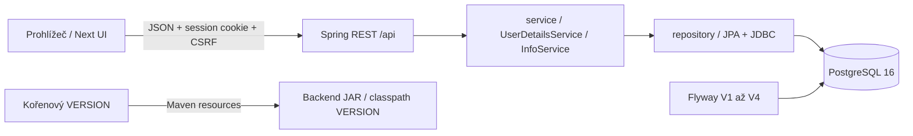

# Architektura technického základu a P1–P3

## Implementovaný rozsah E0 + P1–P3

Monorepo: `backend/` je Spring Boot 4/Java 17 s původním package `cz.jpmad.springprojecttemplate`; `frontend/` je samostatný Next.js App Router/TypeScript. PostgreSQL 16 má po V4 stále 12 tabulek. P1 pokrývá identitu/setup/sporty, P2 sezóny, týmy, offline hráče, intervalová členství a scoped soupisky/historii. P3 doplňuje správu účtů, rodičovské vazby, Moje děti a omezený CHILD login. Úplná akceptace E1 ani celá klubová aplikace nejsou uzavřené. Kořen uchovává VERSION, LICENSE, Compose a týmové materiály. Business logika a autorizace zůstávají ve Springu. Žádný NextAuth, JWT, OAuth, Redis nebo mikroservisy nejsou potřeba.

Zachované vrstvy `api`, `config`, `model`, `repository`, `service` používají constructor injection a DTO records. `User` má UUID, BCrypt passwordHash, USER/ADMIN, typ STANDARD/CHILD, enabled, dočasně volitelný person a auditní časy. Veřejná registrace stále přijímá jen username/password a vytváří USER/STANDARD s PENDING osobou. GET/POST `/me/person` umožní vlastní údaje doplnit; nepřipojuje existující cizí osobu. P3 přidává admin správu účtů na ověřené existující osoby, person-link pro dosud nepropojený účet, odůvodněné změny rolí/typu/přístupu a samostatnou CHILD aktivaci. Použitou osobu nelze přepojit a posledního povoleného správce nelze odebrat.

P1 načítá aktuální účet i při použití existující session. Neúplný účet nemá klubový rozsah; deaktivovaný účet je blokovaný. CHILD se aktivuje jen s vlastním hráčem a schváleným aktivním STANDARD rodičem. P3 context vrací ADMIN osm správních capabilities, vlastní ownPlayerId, skutečné schválené děti s READ_CHILD a READ_TEAM z dnešních vlastních/trenérských/dětských členství. CHILD ignoruje coach/guardian scope a má jen vlastní hráčské týmy. Frontend poskytuje skutečné identitní, týmové, account a rodičovské obrazovky. Capabilities nejsou vstupem, kterým si klient může přidělit oprávnění.

Setup vyžaduje dokončenou vlastní osobu a soukromý `CLUB_SETUP_TOKEN`; prázdný jej vypíná. Pod zámkem klubu proběhne jediné převzetí a audit. Po setupu má tentýž účet ADMIN, ale zatím žádné trenérské přiřazení. Správa sportů zahrnuje stránkovaný seznam, vytvoření a změnu názvu/aktivního stavu, stabilní kód a žádné mazání.

## Session a chyby

API klient používá `withCredentials`. Před každou mutací načte `GET /api/auth/csrf` a jeho token předá v `X-CSRF-TOKEN`. Token je uložen v HTTP session a klient dostává maskovanou hodnotu pro standardní XOR ochranu Spring Security. Přihlášení volá session authentication strategy (změna session ID a zrušení starého CSRF tokenu) a explicitně ukládá security context. Token se proto získává znovu i po přihlášení/odhlášení. Mutace se při chybě neopakují automaticky.

`POST /api/auth/logout` obsluhuje jediný Spring Security logout filter: invaliduje session, smaže kontext i cookie JSESSIONID na cestě /api. Paralelní logout controller, HTTP Basic a remember-me jsou odstraněné; není zaveden limit souběžných sessions. Odpovědi controllerů i security filtrů používají tvar `timestamp`, `code`, `message`, volitelně `details`. 401 znamená nepřihlášeného nebo neplatné údaje; 403 odmítnutou akci nebo CSRF. Frontend rozlišuje anonymní stav a nedostupnost serveru, při selhání logoutu netvrdí úspěšné odhlášení.

P3 ukládá do session neveřejnou autorizační revizi účtu. Změna role, typu, enabled, person-link nebo automatické zakázání dítěte zvýší `users.auth_revision`; filtr porovná původní session revizi s aktuální DB před obnovením principalu. Dřívější cookie proto neobživne při opětovném povolení účtu, ani pokud nebyla během zákazu použita. Vlastní onboarding a setup zachovají svou session pouze po ověření očekávané revize právě provedené operace. Ztráta jedné z více platných rodičovských vazeb dítě neblokuje, ztráta poslední ano. Nové schválení či povolení rodiče vyžaduje novou explicitní aktivaci dítěte. CHILD allowlist odmítá i předběžné finanční/notifikační cesty; nejde o implementované finance nebo notifikace.

Cookie je HttpOnly a SameSite=Lax. Výchozí backend konfigurace je Secure=true, dev profil a lokální Compose Secure=false; HTTPS override nastavuje true. Produkční nasazení má UI a API pod jednou doménou. CORS čte explicitní seznam origins z prostředí, žádná wildcard s credentials; servlet context-path /api není součást controller mappingu ani security matcheru. Veřejné jsou CSRF/login/register, info, dokumentace API a minimální actuator health. `me` vyžaduje session, ostatní Actuator endpointy ADMIN.

## Databáze a verze

V1 zůstává beze změny. V2 přidává `persons`, `club`, `audit_log` a `sports`, rozšiřuje users a převádí staré role při zachování UUID, hashů a časů. Původní role se uchová v neveřejném `legacy_role`; COACH/PLAYER/PARENT se převedou na USER bez domyšlených vazeb. Existující ADMIN zůstává a migrace uzavře bootstrap. `person_id` je přechodně NULL; žádná falešná jména se nevytvářejí. NOT NULL vyžaduje pozdější samostatný ověřený backfill. V3 přidává sezóny, týmy, team_seasons, player_profiles, guardian_links a dvě členské tabulky. V4 přidává auth_revision, ochranu neměnné identity/CHILD/rodičovských cyklů a automatické zakázání dítěte bez aktivního rodiče. Starší CHILD účty při upgradu zakáže bez domýšlení osoby či vztahů. Dalších 26 tabulek DBML není implementovaných. Relační týmové a rodičovské dotazy jsou v TeamDomainRepository a AccountDomainRepository přes NamedParameterJdbcTemplate; P1 entities/UserService zůstávají JPA. Oba používají stejný datasource a Spring transakci, včetně auditu a rollbacku atomického vytvoření osoby/hráče. Hibernate validuje mapované entity; V3/V4 omezení se ověřují na skutečném PostgreSQL migračními/integračními testy; konkrétní výsledky uvádí ověření. SQL nemá místo v controllerech.

P2/P3 čtou pod sdíleným a zapisují pod výhradním zámkem klubu, poté znovu ověří účet. Scoped items i counts mají stejný dotaz. Jedna operace zachytí jediný klubový den v Europe/Prague pro oprávnění i data. EXCLUDE s btree_gist brání překryvům členství; trigger a service kontrolují hranice sezóny, archivaci, povolený účet trenéra a externí soupeře. Budoucí P5 musí doplnit invarianty účastí událostí, které v P2 ještě neexistují.

Flyway je aktivní ve vývoji, testech i produkci; baseline-on-migrate není zapnutý a Hibernate ddl-auto=validate. Dev profil nezakládá žádný default účet. Jediným zdrojem app verze je kořenový VERSION, přibalený do JAR pomocí Maven resources; ruční kopie v backend resources neexistuje. InfoService zachovává renderování Markdownu a `info.cacheTtlMs`. Provedené běhy patří do [ověření](verification.md), tento popis nezaručuje jejich výsledek.

## Navazující architektura — návrh, dosud neimplementováno

Jednotlivé domény rozšiřují stejné vrstvy. Autorizační pravidla běží v transakčních službách a omezují také dotazy podle týmu a vztahu rodič–hráč. Schránkové notifikace a doručení se zapisují transakčně s doménovou změnou, splatnosti hlídá idempotentní scheduler; komunikace má vlastní konverzace a zprávy. Výsledky a agregace používají verzovaná pravidla soutěže, statistiky mají administrátorské datové definice. Jedna instalace podporuje více sportů, každý tým má právě jeden sport. Účty hráčů a rodičů jsou volitelné; samostatný trenér může být jediným uživatelem se správou instalace. Dětské přihlášení již v P3 vyžaduje schváleného rodiče a typ CHILD; příští domény musí zachovat výslovný zákaz financí a povolovat nové sportovní cesty až s jejich validacemi. Podrobnosti v [doménovém modelu](domain-model.md), [databázovém modelu](database.md) a [autorizaci](authorization.md).

Frontendová ochrana dashboardu je navigační pomoc; skutečné oprávnění ověřuje server. Doménový ERD není již nasazené schéma a roadmapa není seznam hotových funkcí.
